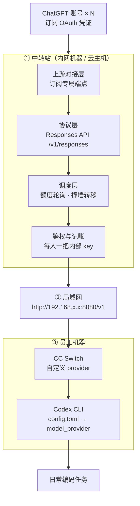

# OurGPT — 局域网 ChatGPT 中转站

> 目标：把若干 ChatGPT 账号聚合成一个内网服务，让团队成员用自己习惯的 Codex CLI 接入，额度统一调度、用量统一记账。

---

## 0. 结论先行

**能实现。四段链路全部打通，每一段都有可复用的现成件，不需要从零发明。**

| 项 | 判断 |
|---|---|
| 技术可行性 | ✅ 高。这是已被广泛实现的成熟形态 |
| 用现成项目跑通 | **2–3 天** |
| 从零自研 | **2–3 周** |
| 长期维护成本 | **远大于开发成本**（见 §5） |
| 合规性质 | ⚠️ 上游是订阅凭证 → 凭证跨人共享，违反 OpenAI ToS。**性质由上游决定，见 §8** |
| 最大风险 | 单点断供：账号被停 → 全员同时不可用 |

三个必须先接受的现实：

1. **中转站不生产额度，只搬运额度。** 3 个账号就是 3 条 5 小时窗口，中转站能做的是把利用率从人工的 ~60% 提到 ~95%，不是把 3 份变多。
2. **单点故障。** 中转站挂了 / 账号被停，所有人一起停，没有缓冲。
3. **这是需要有人守着的系统**，不是装上就不用管的工具。

---

## 1. 需求背景

| 项 | 现状 |
|---|---|
| 团队规模 | 5 人以内 |
| 使用工具 | Codex CLI / Codex 桌面端 |
| 账号来源 | 每人一个个人 Plus，第三方渠道代充（约 135–180 元/月/人） |
| 主要痛点 | ① 个别开发岗 5 小时窗口不够用 ② 采购与报销分散，无集中账单 ③ 账号资产归属在员工个人邮箱 |
| 目标形态 | 一个中转站，局域网分发，员工用 CC Switch 自定义 provider 接入 |

**需求本质**：不是省钱，是"额度调度（谁不够就切到有余量的号）+ 集中管理"。

---

## 2. 架构



### 各段职责

| 段 | 做什么 | 关键点 |
|---|---|---|
| ① 上游对接 | 用账号凭证调用订阅专属端点 | 凭证有效期有限，需刷新机制 |
| ② 协议层 | 上游协议 ↔ 下游 OpenAI 兼容协议 | **必须是 Responses API，不是 chat/completions** |
| ③ 调度层 | 选账号、撞墙转移、限流排队 | 转移时必须接上已生成内容 |
| ④ 鉴权记账 | 每人独立 key，记录 user × 账号 × token | 这是"月底说得清"的唯一依据 |
| ⑤ 客户端 | CC Switch 管 provider，Codex CLI 消费 | 全场最简单，5 分钟配完 |

---

## 3. 技术选型

### 3.1 现成项目（推荐先跑这部分）

> 以下项目名与定位来自技术调研，**版本与存活状态需自行核实**（本文档写作时本机无法访问 GitHub API）。

| 项目 | 定位 | 适用性 |
|---|---|---|
| `sub2api` | 订阅池化 + 多租户配额面板 | **最接近本需求形态，优先试** |
| `New API` | 通用网关骨架（多用户 / 令牌 / 渠道 / 计费） | 做鉴权与记账的骨架好；订阅渠道需自行扩展 |
| `one-api` | 同上，社区活跃 | 同上 |
| `CLIProxyAPI` | 把 CLI 的 OAuth 身份包装成 OpenAI 兼容端点 | 上游对接层可直接参考 |
| `CC Switch` | 客户端 provider 配置管理 + 本地代理 + 用量统计 | **只做客户端层**，不是服务端 |

### 3.2 选型第一问（不要跳过）

问自己、也问候选项目一句话：

> **「你的下游端点支持 `/v1/responses` 吗？」**

回答"只支持 `/v1/chat/completions`"的，**直接淘汰**。Codex 走的是 Responses 协议，接了 chat 端点会导致工具调用和流式输出异常。这是本项目最容易踩、也最贵的一个坑。

### 3.3 推荐路线

```
第 1 步：拿 sub2api 或 New API 跑通单账号单用户
第 2 步：确认它能正常支撑一轮真实的 Codex 编码任务（含工具调用）
第 3 步：判断是继续用，还是只借鉴它的架构自己写
```

**先跑通，再决定要不要自研。** 不要一开始就写代码。

---

## 4. 三个决定成败的硬点

### 4.1 协议：Responses API

- Codex CLI 调用的是 `/v1/responses`
- `config.toml` 里对应字段是 `wire_api = "responses"`
- 下游网关若只实现 chat completions，表现为：能返回文本，但**工具调用失效 / 流式中断 / 任务无法多轮**

**验收标准**：让 Codex 完成一个需要读写文件 + 执行命令的任务（不是简单问答），全流程无异常。

### 4.2 撞墙转移：流必须接得上

- 上游额度耗尽通常返回 `429`
- 此时如果直接切断，用户看到的是任务跑到一半重来
- 正确行为：识别额度类错误 → 切到下一个账号 → 重新发起该轮 → **把已生成的部分保留在上下文里**

**验收标准**：手动把当前账号额度压到耗尽，观察任务是否连续完成、不丢上下文。

### 4.3 凭证刷新：长期维护的真源头

- 账号凭证有有效期，必须能自动刷新
- 账号越多、刷新失败的面越大
- 刷新失败 → 该账号从池里掉出 → 需要告警，而不是静默失败

**验收标准**：跑满一个凭证周期（数天），观察是否需要人工干预。

---

## 5. 落地计划（分阶段，每阶段有验收）

### Phase 0 — 单账号打通（约半天）

- [ ] 起一个网关服务
- [ ] 配 1 个账号的上游凭证
- [ ] 发 1 把内部 key
- [ ] Codex CLI 指向它，跑通一个改代码任务

**验收**：`codex` 能正常读写文件、执行命令，无报错。

### Phase 1 — 多用户与记账（约 1 天）

- [ ] 发 3–5 把内部 key，模拟全员
- [ ] 每请求落一条记录：时间 / user / 上游账号 / 输入输出 token / 是否 429
- [ ] 出一张按人汇总的表

**验收**：能回答"某人某天用了多少、走的哪个账号"。

### Phase 2 — 多账号与撞墙转移（约 1 天）

- [ ] 接入第 2 个账号
- [ ] 实现按剩余额度选号
- [ ] 实现 429 自动转移且任务不中断

**验收**：压测时任务连续完成，日志里能看到账号切换记录。

### Phase 3 — 局域网分发（约半天）

- [ ] 服务固定在局域网内一台机器，固定 IP
- [ ] 反向代理 + HTTPS（自签亦可）+ 访问控制
- [ ] 每台员工机器装 CC Switch，添加自定义 provider
- [ ] 员工端跑通

**验收**：员工在自己电脑上，全程不需要你协助，完成一次编码任务。

### Phase 4 — 运维起步（持续）

- [ ] 账号健康检查与告警
- [ ] 用量周报
- [ ] 凭证备份与轮换流程

---

## 6. CC Switch / Codex 配置要点

### CC Switch 侧

添加一个"自定义 provider"，填三项：

| 字段 | 值 |
|---|---|
| Base URL | `http://<中转站内网IP>:8080/v1`（注意结尾 `/v1`） |
| API Key | 你发给该员工的内部 key |
| 模型 | 中转站对外暴露的模型 ID |

### Codex 侧（`~/.codex/config.toml`，Windows 为 `%USERPROFILE%\.codex\config.toml`）

```toml
model = "<对外模型 ID>"
model_provider = "ourgpt"

[model_providers.ourgpt]
name = "OurGPT"
base_url = "http://<中转站内网IP>:8080/v1"
env_key = "OURGPT_API_KEY"
wire_api = "responses"
```

Key 走环境变量，**不要写进配置文件、不要进 Git**。

> 注意：Codex 的配置文件与 CC Switch 管的可能是同一份。若两者同时改，以环境变量优先级更高，容易"配了却不生效"——**统一用 CC Switch 管理，别手改**。

---

## 7. 运维约束（先确认，会改变架构）

| 约束 | 影响 | 处理 |
|---|---|---|
| **有无远程办公** | 内网部署 → 在家连不上 | 有远程需求就必须考虑公网部署或内网穿透，暴露面和成本都上升 |
| 局域网 IP 固定 | 否则员工配置失效 | DHCP 保留地址或写死静态 IP |
| HTTP 明文 | 内部 key 会明文传输 | 加 Basic Auth + Caddy 自动 HTTPS |
| 防火墙 | 员工连不上 | 放行端口，仅限内网网段 |
| 单点故障 | 服务挂了全员停工 | 需备份启动脚本与凭证；至少写清恢复步骤 |

**其中"有无远程办公"是唯一会改变整体架构的变量，必须先确认。**

---

## 8. 合规边界（必读）

中转站代码本身是中性的。决定性质的是**上游凭证类型**：

| 上游凭证 | 性质 | 说明 |
|---|---|---|
| ChatGPT / Codex **订阅 OAuth** | ❌ 违规 | ToS 明确"不得共享账号凭证或让他人使用你的账号"。多人经中转站共用 = 凭证跨人流动 |
| 平台发放的 **API key**（如 WorkBuddy `ck_`、公司自有 API key） | ✅ 正当 | key 本身即设计为程序化调用；企业版还明确积分团队内共享 |
| 第三方代充账号的**登录态** | ❌ 违规 + 额外风险 | 代充的支付来源本身受持续审查，与共享风险叠加 |

**同一套网关，换上游即为两种性质的工具。**

必须让决策者明确知晓的后果：

- 账号被停用时，已购订阅权益在申诉期间不可用
- 停用依据（ToS 那句共享条款）是现成的，没有争议空间
- 同一出口 IP 的多账号交叉活跃会形成关联，一个账号出问题可能牵连其他
- 中转站上的所有对话与代码都在同一批账号下，账号停用 = 上下文一起消失

---

## 9. 替代路径（成本更低的三个）

在中转站之外，这几条覆盖了大部分真实需求：

| 方案 | 月成本（5 人估） | 解决什么 | 代价 |
|---|---|---|---|
| **L0：多账号 + CC Switch 手动切换** | 2–3 个 Plus ≈ 450 元 | 撞墙时人工切到有余量的号 | 0 行代码，但无调度无记账 |
| **档位配对：1 个 Pro + 其余 Plus** | ≈ 1350 元 | 长期不均（开发一直重、方案岗一直轻） | 无需切换；**长期不均用分配解决，短期不均才需调度** |
| **政策兜底：撞墙可买 credits 报销** | 按实际发生 | 临时冲刺不停工 | 零采购变更，今天可生效 |
| 共享额度池（Business 工作空间） | 5 × $20 ≈ 670 元 | 撞墙自动落池继续跑，合法池化 | 需海外主体与 Owner |

**判断公式**：

- 卡在**带宽**（一个人连续跑很久撞墙）→ 给他一个人升档
- 卡在**通道**（多人同时用就变慢）→ 多买几个账号
- 两者都缺 → 只能加钱，单价恒定 $20/份，没有第三种可能

---

## 10. 待确认事项

开工前必须回答：

1. **团队有没有远程办公的人？** —— 决定内网部署还是公网部署
2. **准备接几个账号进池？** —— 决定调度复杂度
3. **有没有一把可用于测试的上游 key？** —— 决定能否本周验证
4. **决策者是否已知晓 §8 的合规性质与后果？** —— 必须书面确认

---

## 11. 一句话总结

> 技术上完全能做：现成项目 2–3 天跑通，自研 2–3 周，四段链路每一段都有成熟实现。
> 但它的收益是"提高已有账号的利用率"，不是"凭空多出额度"；它的代价是一个需要长期维护、单点故障、且上游处于违规侧的系统。
> **在决定做之前，先用 §9 的三条低成本路径测一遍——如果"档位配对 + 报销政策"就够，那就不需要这套基础设施。**

---

## 12. 局域网接入（已实现）

### 服务端

```bash
cd E:\OurGPT
npm start
```

监听 `0.0.0.0:8080`，只接受内网来源（10/8、172.16/12、192.168/16、本机），其他来源返回 403。要放开限制设 `ALLOW_ANY=1`（不建议）。

### 控制台

浏览器打开 `http://<本机局域网IP>:8080/`：

- **按用户用量**：今天/昨天/全部切换，点击用户卡片下钻该用户的上游明细与最近请求
- **模型分组**：按上游（WorkBuddy / Qoder / ChatGPT 网页 / 魔搭 / DeepSeek / Mock）聚合展示，带"工具调用 ✓ / 仅对话 ✕"能力标签，点模型名复制
- **接入信息**：自动探测当前局域网地址（`/admin/info`），换网络后回这里看最新 Base URL
- **内部 Key**：本机浏览器可直接创建 key（`POST /admin/keys`，仅回环地址可调用），生成后一次性显示 key 与 `config.toml` 片段
- 每 5 秒自动刷新用量；服务状态、今日 KPI 置顶

### 发 key

```bash
node scripts/newkey.js <用户名>
```

输出该用户的 key 和 `config.toml` 片段。key 写入 `config/keys.json` 后**自动热加载，无需重启服务**。

### 员工端（Codex CLI）

`~/.codex/config.toml`：

```toml
model = "deepseek-ai/DeepSeek-V4.1-Flash-1017"
model_provider = "ourgpt"

[model_providers.ourgpt]
name = "OurGPT"
base_url = "http://<服务器IP>:8080/v1"
env_key = "OURGPT_API_KEY"
wire_api = "responses"
```

设置环境变量 `OURGPT_API_KEY` 为发到的内部 key。

### 员工端（CC Switch）

| 字段 | 值 |
|---|---|
| Base URL | `http://<服务器IP>:8080/v1`（注意结尾 `/v1`） |
| API Key | 发到的内部 key |
| 模型 | `deepseek-ai/DeepSeek-V4.1-Flash-1017` |

### 防火墙（管理员 PowerShell，执行一次）

```powershell
New-NetFirewallRule -DisplayName "OurGPT 8080 (LAN)" -Direction Inbound -Protocol TCP -LocalPort 8080 -Action Allow -RemoteAddress 10.0.0.0/8,172.16.0.0/12,192.168.0.0/16 -Profile Any
```

### 查用量

```bash
curl "http://<服务器IP>:8080/admin/ledger?user=zhangsan&date=2026-10-28"
```

### 注意

- 当前是 HTTP 明文，内部 key 在内网传输中可见。只在可信内网使用；要出内网必须加 HTTPS。
- 本机 IP 变了员工配置就会失效，建议在路由器上给这台机器做 DHCP 保留。

---

## 13. Qoder 上游（已接入）

通过 Qoder 官方 CLI 的 headless 模式接入 Qoder 模型池，不涉及任何凭证文件提取。

### 前置

```bash
npm install -g @qodercn-ai/qoderclicn
qodercn login        # 浏览器授权一次，凭证由 CLI 自己保存
```

也可在 https://qoder.cn/account/integrations 生成 PAT，写入 `.env`：`QODER_PERSONAL_ACCESS_TOKEN=...`

### 模型

`Auto` `Fast` `Qwen3.8-Max` `Qwen3.8-Flash` `DeepSeek-V4-Pro` `DeepSeek-Flash` `GLM-5.3` `GLM-5.3-Flash` `Kimi-K3.1-Pro` `Kimi-K2.8-Preview` `MiniMax-M3.1-Flash`

模型列表在启动时通过 `qodercn --list-models` 动态刷新（`config/upstreams.json` 的 `qoder.dynamic_models`）。

### 工作方式

每个请求启动一个 `qoderclicn` 进程（`--print --output-format stream-json --tools ""`），stdout 的 stream-json 事件转成 Responses SSE；`usage.credits` 记录本次消耗的 Qoder credits。

### 限制

- **不支持 function calling**：qoder 适配器声明 `tools:false`，模型能正常对话，但 Codex 派发的工具任务不会被模型调用工具（Codex 会收到纯文本）。
- 每请求冷启动约 8–10 秒。
- 消耗 Qoder 账号 credits（不是 API 额度）。
- 依赖 CLI 登录态；过期需重新 `qodercn login`。
- 运行环境需清掉桌面版注入的 `QODER_AGENT_SDK_*` / `QODER_SDK_AUTH_PAYLOAD_FILE`（适配器已自动处理）。

---

## 14. ChatGPT 网页版上游（chatgpt-web，已打通）

Free 套餐账号无法使用 Codex OAuth 后端（401），但网页版界面可用。本适配器通过 Chrome 调试端口复用已登录的网页会话：把提示词输入页面、点发送、读回最终回复。

### 前提

```powershell
# 1. 启动专用 Chrome（自动带上系统代理，CDP 端口 9222，独立 profile）
powershell -ExecutionPolicy Bypass -File scripts\chatgpt-web-browser.ps1

# 2. 在弹出的窗口里登录 chatgpt.com（一次即可）

# 3. 网关照常运行
npm start
```

### 模型

`gpt-6-web` —— 实际模型由网页的模型选择器决定（当前 GPT-6）。

### 工作方式

`adapters/chatgpt-web.js` 连接 `127.0.0.1:9222`，在 ProseMirror 输入框写入提示词并回车，轮询页面文本直到回复完成。请求串行排队，单页面一次一个。

### 限制

- 每请求约 50–70 秒（每次先开新对话，避免历史拖慢；页面头像/推荐语可能混入回复末尾）。
- 同一时间只能处理一条（串行队列）。
- 无工具调用，返回的是页面最终文本。
- 依赖网页 UI 结构，页面改版可能失效。
- 消耗账号网页额度；Free 账号受限额策略影响。
- Chrome 必须保持运行且保持登录。
- Codex CLI 指向本网关时必须设置 `NO_PROXY=127.0.0.1,localhost`：系统代理会破坏本地请求体，导致 400。

### 实测

- 网关 → 页面 → 返回 `PONG_WEB`，11.3 秒（首次）。
- Codex CLI → 网关 → 页面 → 返回 `PONG_CODEX` / `PONG_NEW2`，50–70 秒，ledger 记录 `upstream=chatgpt-web`、`status=200`。

### 拿到 Plus 之后

原生通道切换、多账号池、代理与运维方案见 **[docs/plus-relay-plan.md](docs/plus-relay-plan.md)**。

---

*文档版本：v1 ｜ 2026-10-28（Qoder 上游、ChatGPT 网页版上游于同日接入）*
